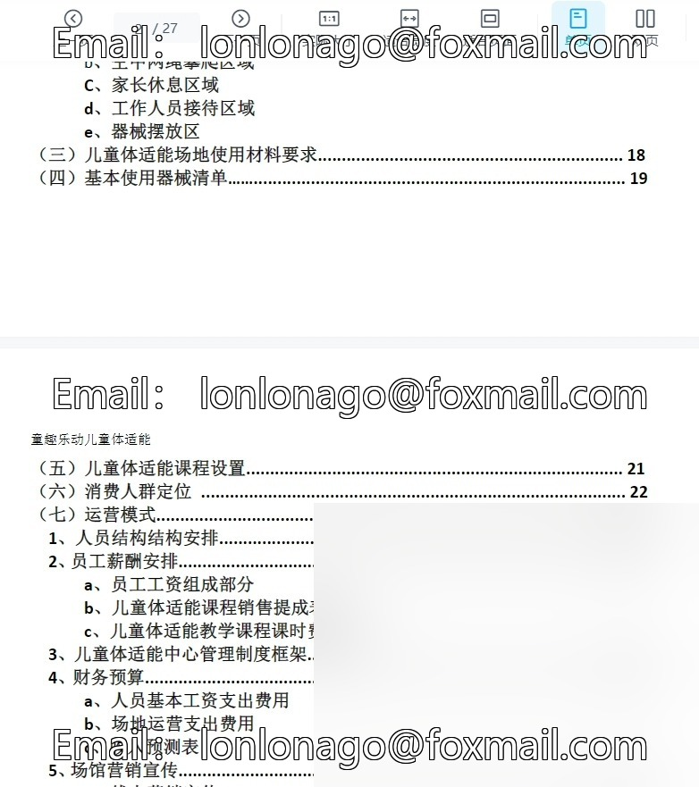
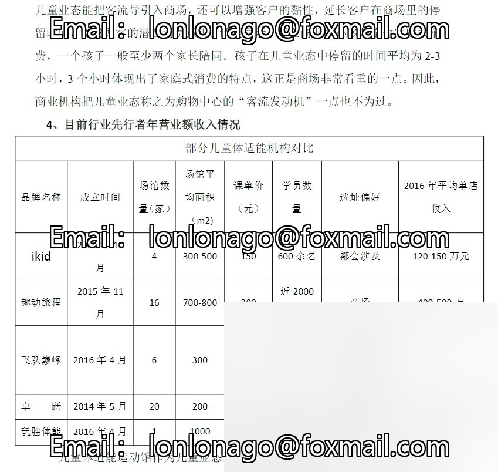

# Children's physical fitness sports hall manual PDF, including: industry situation analysis, physical fitness sports category analysis

## Body

Children's fitness training hall manual pdf, including: analysis of industry current status, types of fitness training, case operation plans, venue decoration design, curriculum settings, consumer analysis, employee management, sales and promotion, etc., detailed introduction.

online trading, and direct ordering allows immediate shipping.
I am online at long-term and will ship immediately.

The manual covers children's fitness concepts, growth problems, domestic and international development, venue layout and design, equipment, courses, operations, marketing, management and finance.

<!-- AI_ENRICHED -->

## Images

## Payment

Here is a pay link on Stripe ( https://buy.stripe.com/3cs8yP7sY87d0vu9AB ). Please contact me lonlonago@foxmail.com after funding $89, and I will send you a complete data files , thank you!

